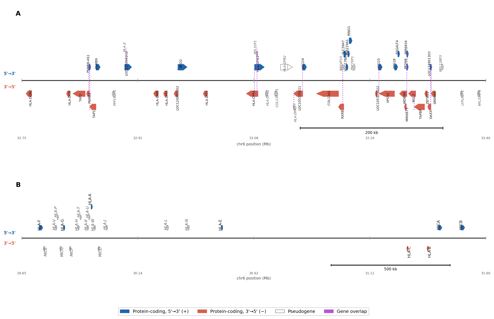
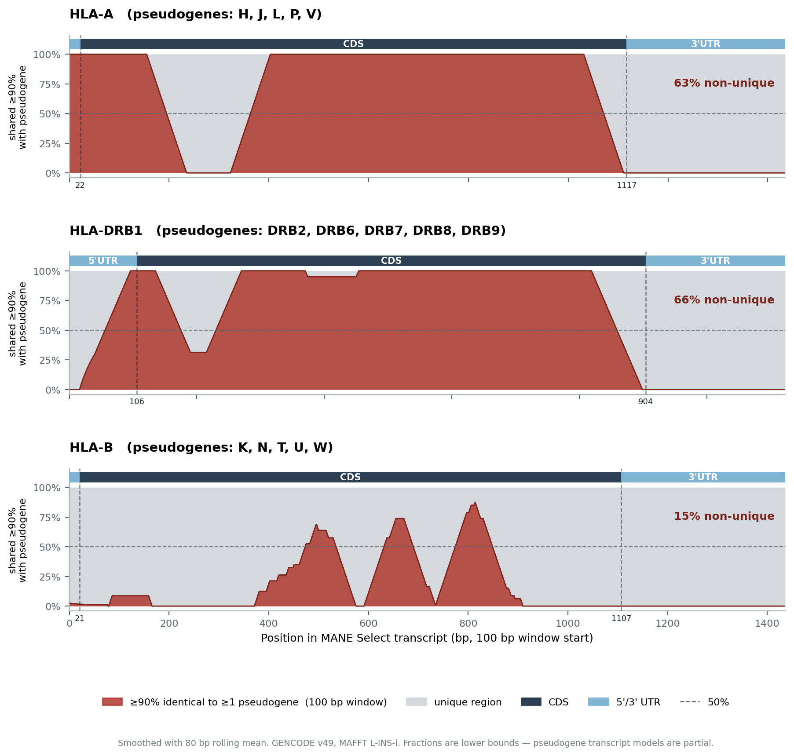

# The HLA / APM locus on chr6p21.3: why it needs special handling

Antigen presentation genes (HLA-A/B/C, TAP1/2, TAPBP, PSMB8/9) sit in the most complex region of
GRCh38. The way it is annotated decides whether a short-read pipeline reports **inflation**
(kallisto/EM: reads redistributed as fractions) or **zero** (STAR unique-only: MAPQ < 255 dropped).
This folder documents the problem with examples and the choices made in this pipeline.

*`Figure_APMlocus/`: (A) TAP–PSMB–TAPBP block with overlapping gene bodies (purple);
(B) class I region: HLA-A/B/C/E/F/G interleaved with pseudogenes HLA-H, J, K, L, N, P, T, U, V, W and MIC genes.*

## 1. Three sources of ambiguity

| source | example | where shown |
|---|---|---|
| **Pseudogene paralogs.** Transcribed, 70–95 % identity in exons 2–3 | 63 % of 100-bp HLA-A windows ≥ 90 % identical to HLA-H/J/L/P/V; HLA-DRB1 66 %; HLA-B 15 %, HLA-C 23 % | `HLApseudo_MAFFT/shared_fraction.tsv`, `hla_shared_fraction.png` |
| **Alt haplotypes and patches.** 8 MHC alt contigs; > 300 alt sequences in the region | TAP1, PSMB8/9, TAPBP, HLA-DPA1/DPB1, MICB have identical copies on alt contigs | table 2 |
| **Overlapping and nested genes.** Antisense or shared gene bodies | PSMB8-AS1/PSMB8/TAP1/PSMB9; TAPBP/ZBTB22/DAXX; HLA-A in a 35-gene overlap group | `Figure_APMlocus`, `mappability/smallPhenomena/08B_HLA_MHC/gene_classification.tsv` |
| **Polymorphism.** Thousands of alleles; GRCh38 carries one mosaic haplotype | non-reference alleles mismatch → lower AS, more multimapping | `HLA_MAFFT/`, `Reference/MANE/HLA_alleles_MAFFT/` |

## 2. Same simulated reads, different references: STAR gives zero

Uniform simulated 100-bp PE reads (the truth is that every transcript is fully expressed).
The values are funique, the MAPQ-255 fraction (`star_funique_by_reference_L100.tsv`).

| gene | genome + alt (RefSeq p14) | dedup CDS | MANE only | **Ensembl primary (used)** |
|---|---|---|---|---|
| HLA-A | 0.43 | 0.32 | 1.00 | **0.89** |
| HLA-B | 0.46 | 0.52 | 1.00 | **1.00** |
| HLA-C | 0.17 | 0.12 | 1.00 | **1.00** |
| HLA-E | **0** | 0.01 | 0.99 | 0.99 |
| HLA-DPA1 / DPB1 | **0 / 0** | 0.12 / 0.04 | 1.00 | 1.00 |
| TAP1 / TAP2 | **0 / 0.02** | 0.04 / 0.01 | 1.00 | 1.00 |
| TAPBP | **0** | 0.11 | 1.00 | 0.98 |
| PSMB8 / PSMB9 | **0 / 0** | 0.10 / 0.11 | 1.00 | 1.00 |
| MICB | **0** | 0 | 1.00 | 1.00 |
| B2M (chr15) | 0.11 | 0.06 | 1.00 | 1.00 |

With alt contigs, every read from TAP1, PSMB8/9, TAPBP and HLA-DP is non-unique.
A unique-count pipeline reports the complete peptide-loading machinery as **not expressed**.
Removing alt contigs and patches (the Ensembl primary assembly, as nf-core/rnaseq recommends)
restores 1.0. Only true paralog sharing is left, as in HLA-A (0.89 at L100, 0.88 at L75).

## 3. EM splitting: kallisto gives fractions

The same uniform reads, kallisto against MANE transcripts versus against the deduplicated RefSeq CDS
(the truth is about 51.5 TPM for every transcript; `kallisto_truth_vs_dedupCDS.tsv`, PE 100 bp):

| gene | TPM, MANE index | TPM, dedup-CDS index | effect |
|---|---|---|---|
| TAPBP | 51.5 | 28.9 | −44 % (split with isoform/alt copies) |
| TAP2 | 51.5 | 39.3 | −24 % |
| MICA | 51.5 | 42.2 | −18 % |
| HLA-A / B / C | 51.5 | 45.2 / 45.2 / 45.2 | −12 % |
| HLA-G | 51.5 | 0.02 | lost to paralogs |
| HLA-DPA1 | 51.5 | 0 | lost |
| B2M | 51.5 | 57.2 | **+11 % inflation** (absorbs reads from similar copies) |

**Isoforms add to this.** Annotated CDS isoforms in the dedup index (`mappability/smallPhenomena/01_isoform_redundancy/isoform_table.tsv`):

| gene | TAPBP | TAP2 | HLA-A | HLA-B | HLA-C | TAP1 | PSMB8 | PSMB9 | B2M |
|---|---|---|---|---|---|---|---|---|---|
| number of isoforms | 14 | 8 | 8 | 8 | 6 | 3 | 3 | 2 | 2 |

Isoforms share most exons, so EM splits a gene's signal between them. The largest kallisto losses
(TAPBP −44 %, TAP2 −24 %) are in the genes with the most isoforms. Moving from a CDS-only index to
UTR–CDS–UTR MANE transcripts rescues about 90 % of genes (unique fraction about 3 % → 94 %); about 1,900 genes
are not rescued (`01_isoform_redundancy/README.md`). One transcript per gene (MANE) gives up isoform resolution
in exchange for this; for 9-mer net sums that is the intended level (`1gene_1canonicalProtein`).
*Status: the isoform and case-study analyses in `mappability/smallPhenomena/` are in progress;
02, 04–07 contain only `analyze.py`, and the gene-level recommendation table covers 27 genes so far.*

Genome-wide (19,423 transcripts): 47 % are more than 10 % too low, 6 % more than 10 % too high, 21 % zero,
and 25 % within ±10 % of the truth (`results/tables/phenomena_kallisto_dedupCDS_classes.tsv`).
EM does not report ambiguity. It hides it in fractional counts that depend on how expression is spread
across all the competitors, and in cancer that spread changes with pseudogene de-repression.

## 4. What this pipeline does (optimisation)

| step | choice | effect |
|---|---|---|
| Expression reference | MANE Select transcriptome (1 transcript/gene) as a pseudo-genome; STAR `--alignIntronMax 1` | no alt, patch or pseudogene competitors; TAP/PSMB/HLA-DP counted |
| Counting | featureCounts fcM (`-M --fraction`) for totals; fc (unique) only for the `shared` test and allele ratios | multimappers are not silently lost |
| HLA | personal MANE: MANE UTRs + the sample's IMGT CDS (`build_personal_MANE_utr.py`) | allele-specific k-mers; correct protein for 9-mers |
| HLA totals | allele sum of **fcM**; allele split by unique-read ratio | with fc, heterozygous HLA loses 19–82 % (reads fit both alleles; `tests/trim_personal/hla_personal_impact.tsv`) |
| Pseudogene residue | ×funique only if f < 0.9 **and** pseudogene evidence **and** shared < 0.10 | HLA-A ×0.877 (L75) / ×0.893 (L100); HLA-B/C, TAP, PSMB f = 1 |
| funique | genomic exon ±50 bp, Ensembl **primary** assembly (194 seqs), STAR 2.7.11b | alt/patch artefacts (table 2) removed |
| Alt-only genes | excluded, with reasons (`excluded_transcripts/`) | KIR, HLA-DRB3/4 (kept in JY), C4A/B not guessed |
| HLA typing | genome-free (OptiType razers3 fishing; arcasHLA from FASTQ) + reconcile | no HLA reads lost to pseudogenes, alt contigs or patches |

## 5. Open issues (not solved)

1. **Expressed pseudogenes have no decoy.** The MANE-only index has no HLA-H/J/L. Reads from a transcribed
   pseudogene land on HLA-A. funique corrects for the *expected* sharing under uniform expression,
   not for the sample's *actual* pseudogene expression (which is higher after de-repression in cancer).
   Candidate: pseudogene decoys in the MANE index. This is not simple (partial models, ties, haplotype-dependent
   pseudogenes, double correction with funique); see [pseudogene_problem/decoys.md](../pseudogene_problem/decoys.md).
2. **Exon-flank simulation has no junction reads.** For short HLA exons this may overestimate uniqueness against
   processed pseudogenes. Option: add a spliced-read (MANE RNA) simulation and compare (designs v1_c/v1_d exist).
3. **Class II (DRB family) is not corrected.** DRB1 sharing is 66–81 %, but on the primary assembly f = 1.0,
   because DRB pseudogenes are partial. Peptide expression of class II is outside this paper's scope.
4. **Strandedness.** Counts use `-s 0` on stranded libraries. Antisense overlaps (PSMB8-AS1, HLA-F-AS1)
   could be separated with `-s 2`. Not tested.

References: Robert & Watson 2015; Deschamps-Francoeur 2020; Derrien 2012; Storvall 2013;
Aguiar 2019; Kang 2023; Morales 2022; Dobin 2013; Liao 2014.
