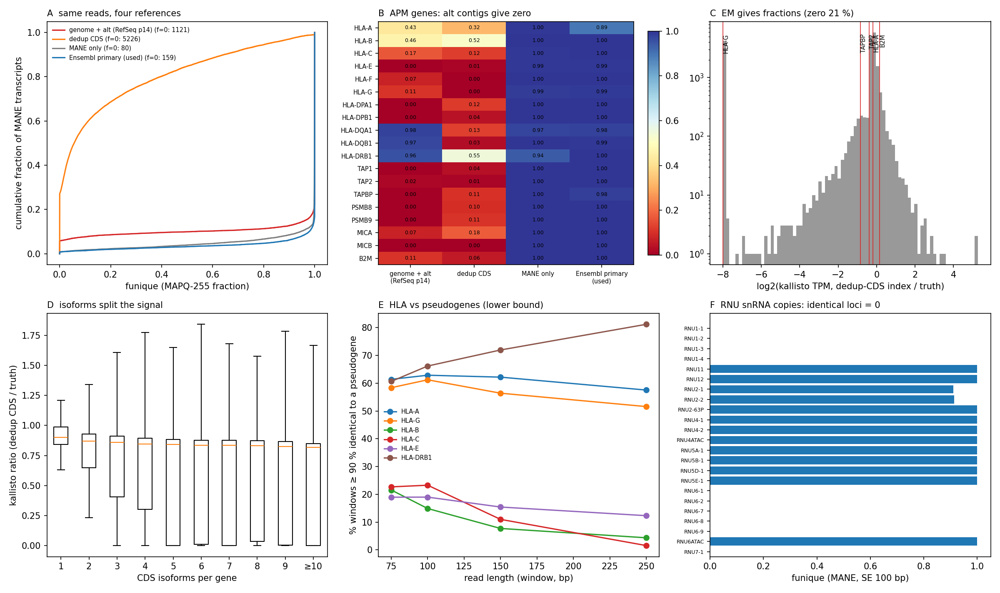

# Mappability phenomena tested

Why a "TPM" from short reads can be wrong, and why this pipeline corrects some genes but not others.
Each row: the phenomenon in one line, the key number, and the folder with the full analysis.
Tables: `results/tables/phenomena_*.tsv`.

*The same simulated reads give zero (STAR, alt contigs), fractions (kallisto, isoforms) or correct
values, depending only on which reference they are counted against. Panels A–F are cited in the
`panel` column below (`scripts/plot_phenomena.py`, existing results only).*

| # | phenomenon | what happens to reads | key number | panel | details | status |
|---|---|---|---|---|---|---|
| 1 | **Alt haplotypes and patches** in the reference | identical copies → MAPQ < 255 → unique counting reports **zero** | genome + alt: 1,125 MANE transcripts with funique 0 at L100 (1,122–1,135 across L75–L150, SE and PE; `mappability/results/transcript_uniqueness_factors_genomic_*.tsv`); TAP1, PSMB8/9, TAPBP, HLA-DP = 0; the primary assembly restores them to 1.0 (TAP1 2,696/2,696 and TAP2 5,655/5,655 positions unique) | A, B | [APM_locus](APM_locus/README.md), `mappability/results/` | done |
| 2 | **Isoforms** (CDS index) | EM splits a gene between isoforms → **fractions** | uniform reads on the dedup-CDS index, 19,423 transcripts: 47 % > 10 % too low, 21 % zero, 6 % > 10 % too high, 25 % within ±10 % (`results/tables/phenomena_kallisto_dedupCDS_classes.tsv`); the drop grows with isoform count (TAPBP, 14 isoforms, 51.5 → 28.9 TPM = −44 %) | C, D | [01_isoform_redundancy](../mappability/smallPhenomena/01_isoform_redundancy/README.md) | partly (gene recommendations for 27 genes) |
| 3 | **Transcribed pseudogenes** (HLA-H/J/L…, DRB2/6/7/8/9) | reads ≥ 90 % identical land on the functional gene → **inflation** | 63 % of 100-bp HLA-A windows shared with A-clade pseudogenes; HLA-B 15 %, HLA-C 23 %, DRB1 66 % (lower bounds) | E | [HLApseudo_MAFFT](../HLApseudo_MAFFT/README.md), [pseudogene_problem](pseudogene_problem/README.md), [decoys](pseudogene_problem/decoys.md) | done; decoys not implemented |
| 4 | **Multicopy identical loci** (RNU1, RNU6, histones) | no unique read at all | at SE 100 bp, RNU1-1…4 and RNU6-1/2/7/8/9: funique 0; RNU2 0.91; RNU4/5/11/12 1.0. The PE exon-flank setting is far harsher — the same RNU4/5/11/12 fall to 0.14–0.32 (`RNU_snRNA/RNU_UF_summary.tsv`) | F | [RNU_snRNA](../RNU_snRNA/README.md) | done; RNUs excluded (non-coding) |
| 5 | **Non-coding share in total RNA** (Ribo-Zero) | snRNA/lncRNA take library mass; their removal renormalises TPM | HCT116 non-coding = 58 % of raw TPM (fcM), 40 % with unique counts; the poly(A) lines carry 0.08–0.18 %. The total rescale from all exclusions plus × funique is ×1.03 for poly(A) and ×2.44 for HCT116 (`tests/library_composition/filter_steps_*.tsv`) | — | [tests](tests/README.md), `report_filter_steps.py` | done |
| 6 | **Overlapping / nested / antisense genes** (PSMB8-AS1, HLA-F-AS1, TAPBP/ZBTB22/DAXX) | unstranded counting (`-s 0`) cannot separate strands | HLA-A in a 35-gene overlap group | — | [Figure_APMlocus](../Figure_APMlocus/README.md), [02_overlapping_annotation](../mappability/smallPhenomena/02_overlapping_annotation/) | not run (only `analyze.py`) |
| 7 | **HLA polymorphism** | non-reference alleles lose alignment score; heterozygous alleles share reads | personal MANE: HLA −9 to +16 %; unique-only counts lose 19–82 % in heterozygotes | — | [HLA_MAFFT](../HLA_MAFFT/README.md), [tests](tests/README.md) | done |
| 8 | **Pseudoautosomal genes** | identical X/Y copies | 17 PAR genes, funique 0 → excluded | — | [excluded_transcripts](excluded_transcripts/README.md) | done |
| 9 | **3′-end protocols (scRNA)** | only the 3′ 250–500 bp is sequenced → different uniqueness | per cell-type marker impact tables | — | [sc3UTRs](../mappability/sc3UTRs/README.md) | done, outside this paper |
| 10 | **Multicopy coding genes** | sequence clusters sharing coding sequence; UTRs rarely rescue | 12,302 MANE genes in 11,991 clusters; UTR rescue strong for 2.1 %, partial 4.9 %, none 87.7 %, lost 5.3 % | — | [04_multicopy_coding](../mappability/smallPhenomena/04_multicopy_coding/) | done |
| 11 | **Local tandem duplications** | STAR discards, kallisto redistributes | 407 MANE genes, 352 clusters; mean funique 0.72, 7.6 % at 0; 24.3 % flagged inflation risk (kallisto assigns where STAR does not) | — | [05_local_duplications](../mappability/smallPhenomena/05_local_duplications/) | done |
| 12 | **Geometrically unique genes** (baseline) | no overlap, no shared sequence cluster | 3,954 MANE genes; funique ≥ 0.9 for 95.8 %, < 0.8 for 3.0 % (repeats inside the gene body) | — | [06_unique_genes](../mappability/smallPhenomena/06_unique_genes/) | done |

**Take-home for this pipeline.** Use the primary assembly for funique (row 1), a one-transcript-per-gene MANE index (row 2),
a personal HLA CDS with fcM totals (row 7), and correct only where a pseudogene explains low uniqueness (row 3).
Row 6 (stranded counting) is open; it needs the BAMs, not new annotation.
