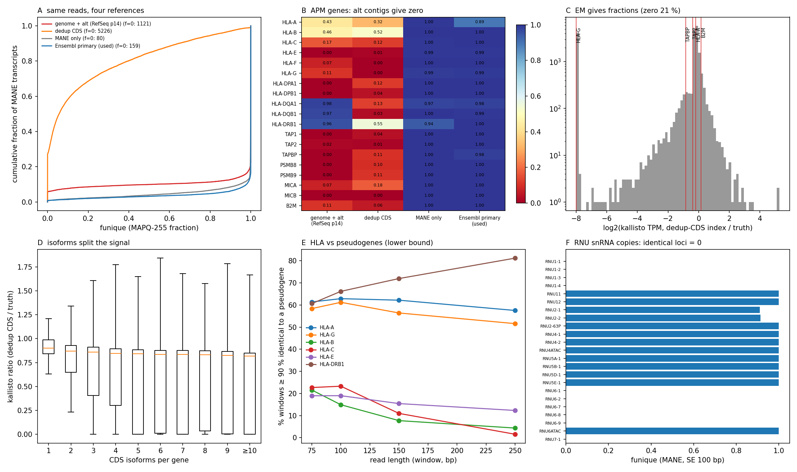
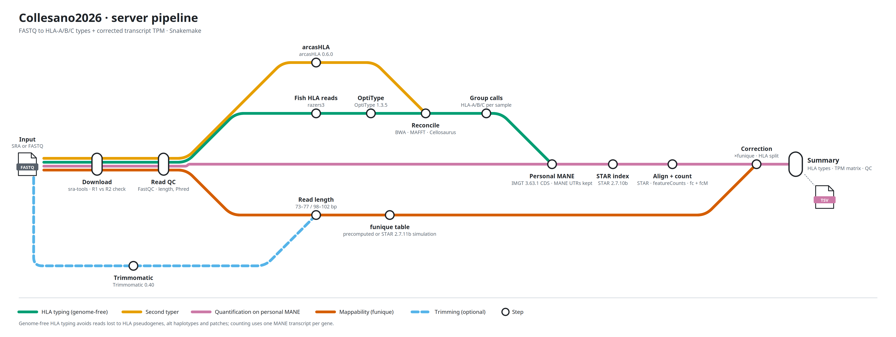
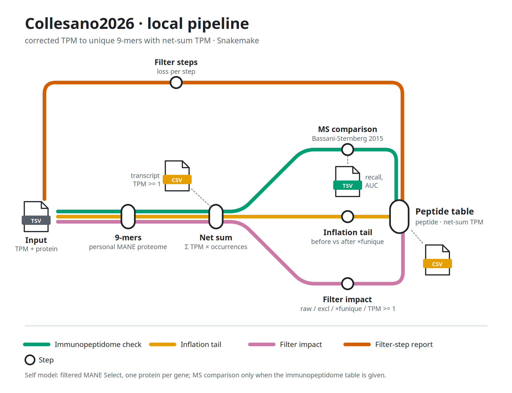

# Collesano 2026 — RNA-seq → HLA types, corrected TPM and 9-mer peptidome

Reproducible pipelines for the expression part of **Collesano et al. 2026** (*Predicting the antigenic
peptidome*, bioRxiv). From paired-end bulk RNA-seq of one sample, they produce:

1. **HLA-A/B/C genotype**: two typers, reconciled with read evidence, checked against Cellosaurus;
2. **corrected transcript TPM**: personal MANE Select transcriptome, STAR + featureCounts, mappability (funique) correction;
3. **unique 9-mers with net-sum TPM**: Σ transcript TPM × occurrences, per peptide of the personal MANE proteome.

**Scope.** This repository covers the RNA-to-peptides part only, ending at the source repertoire of
9-mers and their net sums. The kinetic model of antigen presentation, the cleavage and binding rate
estimates, and the downstream integration with mass spectrometry are published separately, in a
companion repository accompanying the same manuscript. Steps described here feed that analysis and
are not reimplemented there.

| Document | Content |
|---|---|
| [LITERATURE.md](LITERATURE.md) | 26 papers: finding → pipeline step → supports / scoped; full references |
| [LEARNED_LESSONS.md](LEARNED_LESSONS.md) | Why this design: naive self model, isoforms (kallisto vs STAR+fC), UTRs, degradation |
| [INTRO.md](INTRO.md) | One-page introduction: why transcript abundance, why mappability matters |
| [METHODS.md](METHODS.md) | Every step: what, why, which script/rule, reference |
| [LIMITATIONS.md](LIMITATIONS.md) | What the pipeline does not do or measures with a known bias, grouped by topic |
| [ROADMAP.md](ROADMAP.md) | Status, decisions, known discrepancies and open issues |
| [PHENOMENA.md](PHENOMENA.md) | Mappability phenomena tested (pseudogenes, alt contigs, isoforms, multicopy), with figures and links |
| [pseudogene_problem/](pseudogene_problem/README.md) | Why funique exists: the four causes of low uniqueness, which one inflates, and the evidence |
| [APM_locus/](APM_locus/README.md) | Why chr6 HLA/APM needs special handling |
| [excluded_transcripts/](excluded_transcripts/README.md) | The 117 excluded MANE transcripts: every ID and reason |
| [tests/](tests/README.md) | Impact tests: trimming, personal MANE, filtering, inflation tail, HLA typing |


*Why correction is needed: the same simulated reads give zero (STAR, alt contigs), fractions (kallisto, isoforms)
or correct values depending on the reference (details in [PHENOMENA.md](PHENOMENA.md)).*

---

## Pipelines




*Subway maps drawn with [slitherFlow](https://github.com/mikemartinez99/slitherFlow) from `snakemake --rulegraph`
(specs: `docs/subway/*.yaml`).*

<details><summary>text version</summary>

```
server/  (HPC; FASTQ → HLA + corrected TPM)                 local/  (laptop; TPM → peptides)
 fetch (SRA) ─ FastQC ─ Trimmomatic (optional)                 personal MANE protein ─ 9-mers
   │              └─ mean read length → funique table L75/L100/simulate   │
   ├─ OptiType ┐                                              corrected TPM ≥ 1 ─ net sum per 9-mer
   ├─ arcasHLA ┴─ reconcile (support, sites, Cellosaurus)          │
   │                 └─ personal MANE (MANE UTRs + IMGT CDS)       ├─ filter-step report
   └─ STAR (MANE pseudo-genome) ─ featureCounts fc / fcM          ├─ inflation tail
          └─ exclusions · fold · ×funique · HLA split · TPM        └─ MS comparison (optional)
```
</details>

| | server | local |
|---|---|---|
| input | `config/samples.tsv`: SRA run or FASTQ pair, group, condition, Cellosaurus ID | `config/local.yaml`: corrected TPM, personal protein FASTA |
| output | `summary/hla_types.tsv`, `summary/corrected_TPM_matrix.tsv`, `summary/qc_reads.tsv` (read length, Phred), `summary/overview.png` | `<group>/peptide_abundance_<group>.csv` (peptide, mean_TPM, mean_TPM_corrected), reports |
| needs | 16 cores, 40 GB RAM only if a new read length needs a funique simulation; else 16 GB | 4 cores, 16 GB |

## Validation (2026-11-22)

| check | result |
|---|---|
| correction script vs published corrected counts (8 files) | byte-identical |
| HLA calls → personal MANE FASTA, SAF, protein (3 cell lines) | byte-identical to the published references |
| funique table builder (L75, L100) | byte-identical |
| HLA typing, 2 M read pairs, 4 libraries (12 genes) | 12/12 correct after reconciliation (3 rare arcasHLA calls rejected by site evidence) |
| server dry run (5 runs, 3 groups) | 66 jobs, no errors |
| local pipeline on published TPM (3 lines, 19 jobs) | runs end to end; filter-impact and inflation-tail reports identical to `tests/` |

## Key results

| topic | result | where |
|---|---|---|
| **the correction acts on the extreme tail** | the share of 9-mers whose net sum changes rises monotonically with expression: 1.2–1.7 % in the bottom half → 6.7–13.6 % in the 99–99.9 % bin → **31.1–35.6 % in the top 0.1 %**; the share coming from multicopy gene families rises 3.6–4.0 % → 14.7–29.0 %; median factor ×0.8 | `tests/inflation_tail/*_tail_bins.tsv` |
| **expression sits on the pseudogene-bearing transcripts** | 51 % of the 1,444 flagged protein-coding transcripts carry pseudogene evidence, but 14–15 of the 15 most abundant do, in all 5 libraries (binomial p ≤ 6 × 10⁻⁴); median count 36 k–171 k vs 22–45 for the table. EEF1A1, ribosomal proteins (RPL7: 29 competing loci), TMSB4X, and HLA-A itself. The one exception, UBC, is self-homology rather than pseudogenes | [pseudogene_problem/](pseudogene_problem/README.md) |
| non-coding removal (total RNA, HCT116) | non-coding = 58 % of raw TPM (fcM), 40 % (unique counts) | `report_filter_steps.py` |
| TPM ≥ 1 cut-off | removes 24–34 % of 9-mers, 0.1 % of TPM; recall −0.7 to −1.9 points | `tests/filter_impact/` |
| trimming | −2.4 to −3.6 % assigned pairs; TPM Spearman ≥ 0.999 | `tests/trim_personal/` |
| personal MANE | genome-wide no effect; HLA −9 to +16 % (fcM); unique-only counting loses 19–82 % HLA in heterozygotes | `tests/trim_personal/` |
| MS recall (Bassani-Sternberg 2015) — sanity check | 97.7–98.1 % of MS 9-mers are in the source repertoire with transcript TPM ≥ 1 (98.6–98.9 % without it). The × funique step moves it by +0.00 to +0.04 points, so it does not discriminate between pipeline variants; nearly every ligand comes from a gene detected in these bulk RNA-seq libraries. Non-coding exclusion is the exception, and only in the Ribo-Zero line (HCT116 96.64 → 97.68) | `tests/`, `compare_ms_bassani.py` |

Global rank statistics over 9.4 M 9-mers cannot resolve an effect confined to 0.1 % of them, so they are not
reported here as evidence for or against the correction; the bounds are in [LIMITATIONS.md](LIMITATIONS.md).

## Reproduce

```bash
cd Collesano2026
bash server/helpers/download_references.sh refs           # MANE v1.5, Ensembl 116 primary, IMGT 3.63.1
snakemake -s server/Snakefile --configfile config/server.yaml --use-conda --cores 16 -n   # dry run
snakemake -s server/Snakefile --configfile config/server.yaml --use-conda --cores 16
snakemake -s local/Snakefile  --configfile config/local.yaml  --use-conda --cores 4
python3 scripts/plot_phenomena.py                           # from mappability-correction/
```

New sample: add a row to `config/samples.tsv` (`source` = `sra` or `fastq` with paths; `cellosaurus` optional;
`include_drb` = `HLA-DRB3;HLA-DRB4` for DR52/DR53 haplotypes). Read lengths other than 73–77 or 98–102 bp
trigger a funique simulation (once per length). Software versions: `envs/*.yaml`.

## Structure

Folder-by-folder and file-by-file: [ROADMAP.md](ROADMAP.md).

Cite: Collesano et al. 2026 (bioRxiv) and the tools in [METHODS.md](METHODS.md#references).
