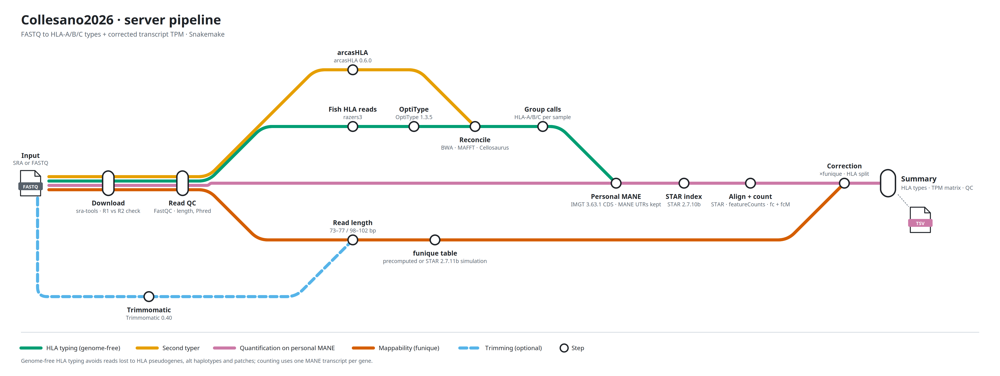
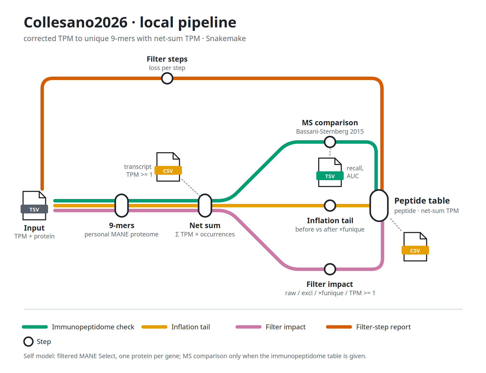

# Subway maps

Both diagrams are wide; click to view at full size, or open the `.svg` for lossless zoom.

## server/ — FASTQ to HLA types and corrected TPM


*Five tracks from one FASTQ. HLA typing runs genome-free (green) with a second typer (yellow) and is
reconciled against Cellosaurus; the reconciled types build the personal MANE reference that
quantification (pink) counts against. Mappability (orange) derives funique from the mean read length,
applied at the correction step. Trimming (dashed) is optional.*

## local/ — TPM to 9-mers


*The personal MANE proteome is reduced to unique 9-mers, each carrying the net sum of its source
transcripts' corrected TPM (Σ TPM × occurrences). Four checks branch off that table: the
immunopeptidome comparison (green, only when an MS table is given), the inflation tail (yellow,
before vs after × funique), filter impact (pink) and the per-step loss report (orange).*

## How they are drawn

Drawn with [slitherFlow](https://github.com/mikemartinez99/slitherFlow) 1.0 (commit 6f4d229).
Drafts come from `snakemake --rulegraph`; station names, tools and rows were edited by hand.

```bash
pip install git+https://github.com/mikemartinez99/slitherFlow
slitherflow draft server --rulegraph <(snakemake -s server/Snakefile --configfile config/server.yaml --rulegraph --nolock) -o draft.yaml
slitherflow render docs/subway/server_subway.yaml -o docs/subway/server_subway.svg --png   # PNG needs rsvg-convert
slitherflow render docs/subway/local_subway.yaml  -o docs/subway/local_subway.svg  --png
```
