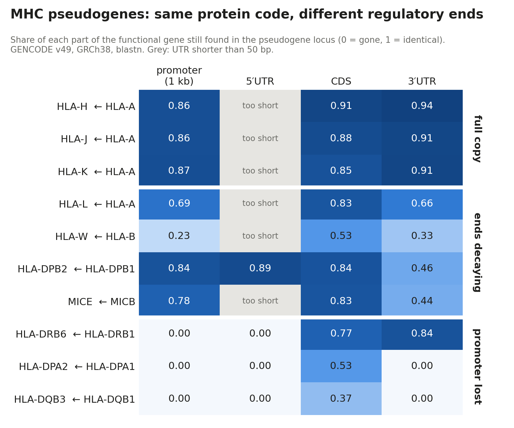

# Example: pseudogene vs parent gene, segment by segment

Do chr6 MHC pseudogenes keep the parent's coding region but lose the promoter/TSS and UTRs?
Ten pseudogene/parent pairs, GENCODE v49 on GRCh38. Each part of the parent's MANE Select transcript (1 kb
promoter, 5′UTR, CDS, 3′UTR) is aligned with blastn to the pseudogene locus ±5 kb. The score is the mean
identity per base of the parent segment (0 = not found, 1 = identical).



| pattern | pairs | meaning for read counting |
|---|---|---|
| full copy | HLA-H/J/K ← HLA-A | promoter, CDS and 3′UTR 85–94 %: can be transcribed, reads compete with HLA-A everywhere |
| ends decaying | HLA-L, HLA-W, HLA-DPB2, MICE | CDS 53–84 %, 3′UTR only 33–66 %: the parent's 3′UTR stays distinguishable |
| promoter lost | HLA-DRB6, HLA-DPA2, HLA-DQB3 | no parent promoter or 5′UTR (DPA2, DQB3 also no 3′UTR); CDS 37–77 % |

So the idea holds for some loci, not all. Class II pseudogenes have lost the parent's promoter, so they are rarely
transcribed and contribute few competing reads. Class I A-clade pseudogenes are near-complete copies, consistent
with transcription and derepression in cancer ([HLApseudo_MAFFT](../../../HLApseudo_MAFFT/README.md)).
HLA-DRB6 is transcribed although the DRB1 promoter is absent, so it must use a promoter of its own.

At the transcript level, the GENCODE models of H/J/L lack most of the 3′UTR, so HLA-A's 3′UTR looks unique
([HLApseudo_MAFFT notes](../../../HLApseudo_MAFFT/notes.txt)). In the genome, HLA-H/J/K keep it at more than 90 %.
A transcript-only reference therefore overstates how unique the 3′UTR is.

Caveats: reference haplotype only; a 1 kb window stands in for the promoter; 5′UTRs under 50 bp are not scored;
repeats are not masked (masking had cut the MICB 3′UTR to 0.14).

```
python3 compare_pseudogene_segments.py gencode.v49.annotation.gtf.gz Homo_sapiens.GRCh38.dna_sm.primary_assembly.fa .
python3 plot_pseudogene_segments.py .
```
