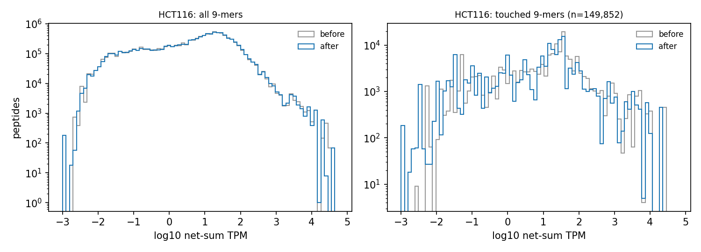

# Tests

Impact of single steps, measured on the paper's data. Local machine; full-library results are from the
published raw counts (fcM), subset results from 2 M read pairs per library.

| folder | question | answer | files |
|---|---|---|---|
| `hla_typing/` | do OptiType and arcasHLA type the three lines from 2 M pairs? | OptiType 11/12 genes at 2 fields; arcasHLA 8/12 (rare alleles B\*07:412, C\*05:185, A\*24:661, C\*03:03); after `reconcile_hla.py` 12/12 | `*_OptiType.tsv`, `*_arcasHLA.json` |
| `trim_personal/` | does Trimmomatic change counts? | −2.4 to −3.6 % assigned pairs; TPM Spearman ≥ 0.999; median abs log2FC 0.02–0.04; 56–176 transcripts cross TPM 1 | `trim_personal_impact.tsv`, `*_trim_summary.txt` |
| `trim_personal/` | does the personal (HLA) MANE change counts? | genome-wide no (Spearman 1.0); HLA −9 to +16 % with fcM; unique-only counts (fc) lose 19–82 % HLA in heterozygous lines | `hla_personal_impact.tsv` |
| `filter_impact/` | do exclusions, ×funique and TPM ≥ 1 change the MS match? | ×funique: recall +0.00 to +0.04 points, |ΔAUC| ≤ 0.0004; non-coding exclusion: +1.04 points in HCT116, ≤ 0.06 elsewhere; TPM ≥ 1: −24 to −34 % peptides, recall −0.7 to −1.9 points | `*_filter_impact.tsv` |
| `inflation_tail/` | does ×funique act on the extreme net sums? | yes, enriched: 31–36 % of the top 0.1 % touched vs 1.2–1.7 % of the bottom half; but 81–86 % of touched 9-mers lie outside the top 10 %; median ×0.8 | `*_hist.png`, `*_tail_bins.tsv` |
| [`library_composition/`](library_composition/README.md) | does removing non-coding RNA make poly(A) and Ribo-Zero lines comparable? | no: replication-dependent histones still hold 1.70 % of coding TPM in Ribo-Zero HCT116 vs 0.036–0.061 % in the poly(A) lines (H4C3 ~1,150 vs ~1 TPM) | `library_composition.tsv`, `histone_tpm_by_library.tsv` |
| `qc/` | read length and Phred of the subsets | HCC1937 75 bp, HCT116 101 bp, JY 99 bp; mean Phred 30.2–36 (JY borderline) | `fastqc_subsets.tsv` |

Scripts: `scripts/run_trim_personal_subsets.sh` (subset alignments; set `SCRATCH`),
`../scripts/impact_filters.py`, `../scripts/inflation_tail.py`, `../scripts/reconcile_hla.py`.
See [ROADMAP.md](ROADMAP.md) for what is still to test.

