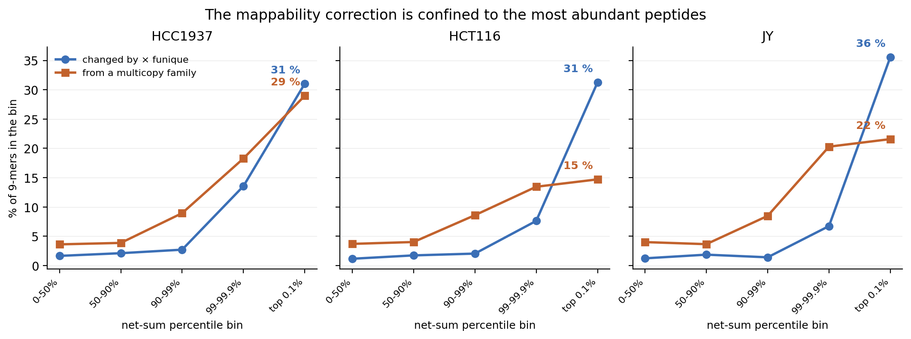

# Where the correction acts: the extreme tail

*Share of 9-mers per net-sum percentile bin that change under × funique (blue) and that come from a
multicopy gene family (orange), for each cell line. Both rise monotonically with expression.*

The share of 9-mers whose net sum is changed rises monotonically with expression, and so does the share
coming from multicopy gene families:

| net-sum bin | 9-mers changed by × funique | from multicopy families |
|---|---|---|
| bottom 50 % | 1.2–1.7 % | 3.6–4.0 % |
| 50–90 % | 1.7–2.1 % | 3.7–4.0 % |
| 90–99 % | 1.4–2.7 % | 8.5–8.9 % |
| 99–99.9 % | 6.7–13.6 % | 13.4–20.3 % |
| **top 0.1 %** | **31.1–35.6 %** | **14.7–29.0 %** |

Ranges are across the three cell lines; per-line values are in `*_tail_bins.tsv`.

This is why global metrics cannot test the correction. A rank statistic over 9.4 M 9-mers cannot move when
the correction reaches 0.1 % of them: across cell lines it shifts the MS AUC by |ΔAUC| ≤ 0.0004, recall by
+0.00 to +0.04 points, and the ranking by Spearman ≥ 0.9977. Those numbers bound the global effect; they
neither support nor refute the correction, because they are not measuring where it acts. The
tail-restricted test is in [tests/tail_validation](../tail_validation/README.md); it is also null,
because only 1–2 % of MS ligands reach the top 0.1 % where the correction bites.

## The same pattern at gene level

Of the 1,444 protein-coding transcripts in the uniqueness-evidence table, 51 % carry pseudogene
evidence; among the 15 most abundant in each library it is 14–15 of 15 (binomial p 4 × 10⁻⁵ to
6 × 10⁻⁴). The one exception is UBC in every library, whose low uniqueness is its own tandem
polyubiquitin repeat rather than a pseudogene. Table and method:
[pseudogene_problem](../../pseudogene_problem/README.md).

## Files

| file | content |
|---|---|
| `*_tail_bins.tsv` | per bin: n, % changed, % multicopy, median log2 ratio, bin floor |
| `*_tail_summary.tsv` | per cell line: peptides, touched, net-sum mass removed, top-10 9-mers before/after |
| `plot_tail_gradient.py` → `tail_gradient.{png,pdf}` | the figure above |
| `*_hist.png`, `*_shift.png` | net-sum distribution before/after, and the per-peptide shift |

Generated by [`scripts/inflation_tail.py`](../../scripts/inflation_tail.py).
