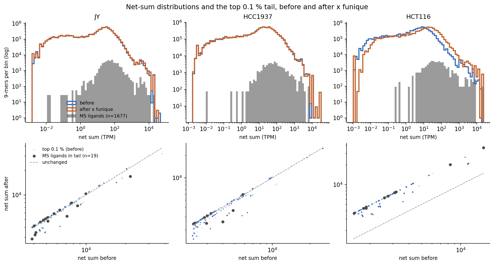

# Tail-restricted validation: does × funique improve agreement with MS where it acts?

Global recall and AUC cannot test the correction, because it reaches ~0.1 % of the 9.4 M 9-mers
([inflation_tail](../inflation_tail/README.md)). This test restricts the comparison to the
expression tail. **Result: no improvement is detectable at the peptide level, and a
gene-level effect in the predicted direction is suggestive but not established.** The reason is
structural — the correction and the MS ligands occupy different parts of the distribution.

## Data-handling decisions

| decision | what was done | why |
|---|---|---|
| source of net sums | rebuilt per 9-mer from `master_file_abundance_<cell>.csv` (11.1 M peptide × transcript rows) rather than taken from `peptide_abundance_<cell>.csv` | the published file carries only the corrected value; both before and after are needed |
| "before" | Σ `mean_TPM` over a peptide's transcript occurrences | uncorrected TPM, normalised over the same 19,437 transcripts |
| "after" | Σ `mean_TPM_corrected` over the same occurrences | differs from "before" only by × funique and the exclusions |
| replicates | the replicate-mean table per cell line (`*_corrected_mean_*.tsv`) | matches how the published net sums were built |
| renormalisation | reported, not removed | 462 transcripts change counts in JY, but every TPM shifts because the library total changes. Since the uncorrected transcripts all share one scale factor, their relative order is unchanged and the ranking comparison stays valid |
| MS ligands | `MS_total_expression_<cell>.csv`; both alleles for JY (0201 + 0702) | the ligands this project already uses |
| peptides with zero signal | dropped (`before > 0`) | a 9-mer with no expressed source cannot be ranked |
| control for the rank test | non-ligands sampled from the same 100 abundance bins, 10 per ligand | correcting some peptides downward lifts everything else in rank, so "ligands moved up" is expected under the null and needs a matched comparison |

Inputs are read-only. Nothing is written outside this folder.

## What the distributions show

Quantiles of the net sum, after ÷ before (`netsum_quantiles.tsv`):

| quantile | JY | HCC1937 | HCT116 |
|---|---|---|---|
| median | 1.029 | 1.025 | 2.434 |
| 99 % | 1.037 | 1.014 | 2.374 |
| **99.9 %** | **0.936** | **0.967** | 2.365 |
| 99.99 % | 1.037 | 1.031 | 2.445 |
| max | **0.851** | 0.984 | 2.445 |

For JY and HCC1937 the ratio is a flat ~1.02–1.04 everywhere except the 99.9 % quantile and the
maximum, where it drops below 1. That dip *is* the correction: it removes signal from the most
abundant peptides and the renormalisation lifts everything else slightly. HCT116 is shifted by a
near-constant 2.44× at every quantile — that is non-coding removal in a Ribo-Zero library, not the
correction. The distribution shape is preserved in all three lines.

*Top: net-sum distribution before and after, with MS ligands overlaid (grey). Bottom: the top 0.1 %
of peptides, after vs before; points below the diagonal were demoted by the correction.*

## Why the test has no power

Where MS ligands actually sit in the corrected net-sum distribution (`ms_position.tsv`):

| cell line | n ligands | median percentile | IQR | above p99 | above p99.9 |
|---|---|---|---|---|---|
| JY | 1,677 | 85.5 | 69.2–94.7 | 7.0 % | 1.1 % |
| HCC1937 | 616 | 85.9 | 69.3–94.8 | 8.3 % | 2.1 % |
| HCT116 | 517 | 86.8 | 70.7–95.8 | 10.1 % | 2.1 % |

MS ligands are mid-to-upper abundance, not extreme. Only 1–2 % of them fall in the top 0.1 %,
which is the one bin where the correction changes a third of all 9-mers. That leaves **11–19
ligands** per cell line inside the zone of action — too few for any statistic to resolve.

## Results

PPV and recall restricted to the tail (`tail_validation.tsv`), change after − before:

| cell line | top 0.1 % | top 1 % | top 10 % |
|---|---|---|---|
| JY | −1 ligand (19 → 18) | 0 (118) | −3 (641 → 638) |
| HCC1937 | +2 ligands (11 → 13) | −3 (54 → 51) | −1 (234 → 233) |
| HCT116 | 0 (11) | +1 (51 → 52) | −1 (222 → 221) |

Changes of one to three peptides, with inconsistent sign — noise.

Paired rank test on every ligand (`ms_rank_shift.tsv`), which has far more power than counting
tail hits:

| cell line | ligands up / down | median rank change | matched control | p vs control |
|---|---|---|---|---|
| JY | 1,645 / 31 | +10,592 | +10,547 | 0.81 |
| HCC1937 | 584 / 32 | +8,248 | +8,246 | 0.76 |
| HCT116 | 507 / 7 | +7,690 | +7,688 | 0.76 |

Almost every ligand moves up, which looks dramatic and means nothing: demoting the inflated
peptides lifts everything else. Against abundance-matched non-ligands the difference disappears
(p = 0.76–0.81). The correction does not move MS ligands differently from any other peptide of the
same abundance.

## Gene-level test: do demoted transcripts carry fewer ligands than their abundance implies?

If inflation is artefactual, a transcript whose signal is inflated has less real protein than its
uncorrected TPM implies, so at a given uncorrected TPM it should yield fewer MS ligands. The unit
is the transcript (peptide-level tests pseudoreplicate: one protein contributes hundreds of
9-mers). `ligand_yield_test.py`

Assumptions checked before fitting:

| check | finding | consequence |
|---|---|---|
| is yield ∝ TPM × length? | **no** — the rate per unit exposure falls 98–254× across exposure deciles | `log(TPM × length)` must not be an offset; both enter as free covariates with a quadratic in log TPM |
| overdispersion | var/mean 1.21–1.42, >90 % zeros | negative binomial (NB2, ML), not Poisson |
| variance-model dependence | Poisson with HC0 sandwich errors gives RR within 0.02 of NB2 | the estimate is not an artefact of the variance model |
| model dependence | a stratum-weighted Mantel–Haenszel RR is run alongside | a raw difference of means across strata is marginal, not adjusted, and stays confounded however finely strata are cut |

Rate ratio for `demoted` (< 1 = fewer ligands than apparent abundance implies):

| cell line | ligands on demoted | NB2 RR (95 % CI) | p | MH RR (95 % CI) | p |
|---|---|---|---|---|---|
| JY | 31 | 0.648 (0.437–0.959) | 0.030 | 0.834 (0.583–1.191) | 0.33 |
| HCC1937 | 31 | 1.220 (0.812–1.832) | 0.34 | 1.412 (0.913–2.185) | 0.12 |
| HCT116 | 7 | 0.338 (0.152–0.753) | 0.008 | 0.422 (0.245–0.729) | 0.011 |
| pooled | 69 | 0.747 (0.573–0.974) | 0.031 | 0.850 (0.669–1.079) | 0.19 |

**Suggestive, not established.** The direction is consistent in JY, HCT116 and pooled, and the
parametric and model-free estimators agree on sign in all four rows. But HCC1937 points the other
way in both; only HCT116 is significant under both, and it rests on 7 observed against 16.6
expected ligands; and pooled significance holds under NB2 (p = 0.031) but not under the weaker
model-free estimator (p = 0.19). With 7–31 ligands on demoted transcripts per line, this is the
resolution the data support.

A related observation does hold firmly: within the top TPM decile, demoted transcripts sit
2.1–2.6× higher in TPM than their stratum-mates. Multicopy and pseudogene-adjacent loci
concentrate where abundance is most extreme, which is why the correction's effect is confined to
the tail.

## Conclusion

The correction cannot be validated or refuted with this ligandome. Three limits, structural rather
than fixable by re-analysis:

1. **Overlap.** 11–19 ligands per line fall in the top 0.1 %, where the correction changes a third
   of all 9-mers. Resolving a PPV change of a few percent there needs an order of magnitude more.
2. **Gene-level power.** 7–31 ligands land on demoted transcripts, giving rate-ratio confidence
   intervals that span 0.15–1.83.
3. **The MS files cannot test recall.** All 517–1,677 ligands are already in the source repertoire
   (100 % recall by construction), so they were matched to it beforehand.

The ligandome itself is well sampled — ligands span the full abundance range and track expression
(median 85th–87th percentile). The constraint is the overlap between where ligands sit and where
the correction acts, so a larger ligandome with deeper tail coverage, not a different statistic,
is what would settle it.

## Files

| file | content |
|---|---|
| `tail_validation.py` | PPV/recall at tail depths, paired rank test, matched control |
| `tail_distributions.py` | quantiles, MS position, the figure |
| `ligand_yield_test.py` | gene-level NB2 + Mantel-Haenszel test with assumption diagnostics |
| `tail_validation.tsv` | PPV and recall before/after at 0.1, 0.5, 1, 5, 10 % |
| `ligand_yield_test.tsv`, `ligand_yield_diagnostics.tsv` | gene-level results and the assumption checks |
| `ms_rank_shift.tsv` | per cell line: ligand rank change vs matched control |
| `netsum_quantiles.tsv`, `ms_position.tsv` | distribution tables above |
| `tail_distributions.{png,pdf}` | the figure |

Run with `--data-dir` pointing at the folder holding `<cell>/master_file_abundance_<cell>.csv`.
