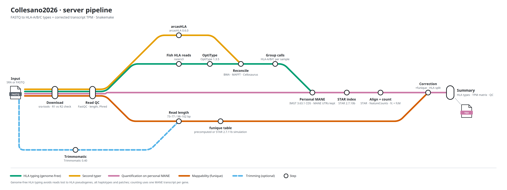
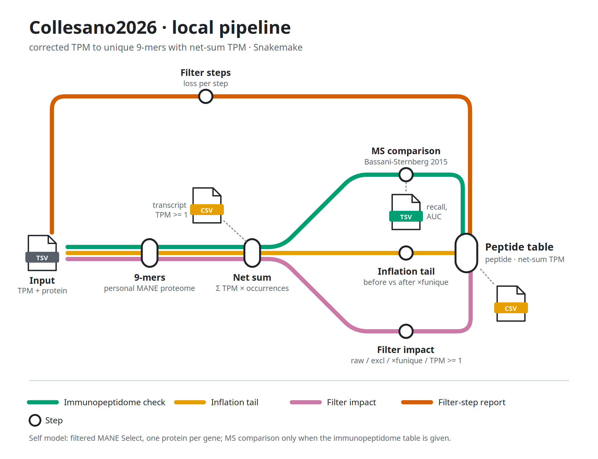

# mappability-correction

**Aim.** Build a *self* peptide repertoire from bulk RNA-seq: every unique 9-mer of the sample's proteome with a
**net-sum expression** (Σ TPM of the transcripts that encode it), comparable with the HLA class I
immunopeptidomes of Bassani-Sternberg et al. 2015. Class I peptides come mainly from newly synthesised, rapidly
degraded products (DRiPs), including the pioneer round of translation before mRNA decay, and preferentially from
actively transcribed, conserved genes. Transcript supply is therefore a meaningful variable
(Yewdell 1996; Schubert 2000; Apcher 2011, 2013; Pearson 2016; Kubiniok 2022).

**Motivation.** Test the expression of self peptides as a variable in HLA-binding prediction. That needs
expression values that are neither inflated (pseudogenes, paralogs, multicopy genes) nor lost (multimapping, alt contigs).
Standard RNA-seq quantification misestimates exactly these gene families (Derrien 2012; Robert & Watson 2015;
Deschamps-Francoeur 2020), and HLA needs a personalised reference (Aguiar 2019; Kang 2023).

**Result.** Mappability-corrected net-sum values from a deliberately simple, naive self model: one filtered
MANE Select protein per gene (Morales 2022), personal HLA-A/B/C, corrected TPM. The correction is concentrated
where it matters: it changes 31–36 % of the most abundant 0.1 % of 9-mers, against 1.2–1.7 % of the bottom half,
because expression concentrates on pseudogene-bearing transcripts: 14–15 of the 15 most abundant
low-uniqueness transcripts carry pseudogene evidence in every library tested, against a 51 % base rate.
Reproducible pipeline:
**[Collesano2026/](Collesano2026/README.md)**.

**The result is a compromise.** Each choice below fixes one artefact and accepts another (details in
[Collesano2026/LEARNED_LESSONS.md](Collesano2026/LEARNED_LESSONS.md)).

| Pipeline maps (Snakemake, drawn with [slitherFlow](https://github.com/mikemartinez99/slitherFlow)) | |
|---|---|
|  |  |

## Technical issues to consider: one or two examples each

| issue | example | consequence | go to |
|---|---|---|---|
| APM locus complexity (chr6) | TAP1, PSMB8/9, TAPBP, HLA-DP: funique 0 on genome + alt haplotypes | unique counting reports zero | [APM_locus](Collesano2026/APM_locus/README.md), [Figure_APMlocus](Figure_APMlocus/README.md) |
| Pseudogenes | HLA-A: 63 % of 100-bp windows shared with HLA-H/J/L; DRB1 66 % | inflation of the functional gene | [HLApseudo_MAFFT](HLApseudo_MAFFT/README.md), [pseudogene_problem](Collesano2026/pseudogene_problem/README.md) |
| HLA typing disagreement | JY: arcasHLA B\*07:412 vs OptiType B\*07:02 (7 of 204 reads support B\*07:412); HCC1937: Cellosaurus record B\*40:16/81:03 | wrong personal proteome | [reconcile_hla.py](Collesano2026/scripts/reconcile_hla.py), [tests](Collesano2026/tests/README.md) |
| Growing genome annotations | GRCh38.p14 RefSeq: 146,337 CDS targets, 14,069 duplicated by patch/alt copies; MANE: 19,437 transcripts | duplicates split or zero the signal | [PHENOMENA](Collesano2026/PHENOMENA.md) #1 |
| Overlapping gene geometry | TAPBP/ZBTB22/DAXX; PSMB8-AS1, HLA-F-AS1 | unstranded reads cannot be assigned | [Figure_APMlocus](Figure_APMlocus/README.md) |
| Multicopy genes | RNU6-1/2/7/8/9, histone clusters (no polyA 3′UTR) | no unique read at all | [RNU_snRNA](RNU_snRNA/README.md) |
| Paralogs | HBA1/HBA2: unique CDS, shared UTR; CALM1-3: near-identical CDS | reads shared or misassigned | [kallisto_results](mappability/kallisto_results/README.md) |
| Repetitive, conserved domains | ZNF C2H2 zinc-finger arrays; olfactory receptors (413 genes) | low uniqueness even with UTRs | [01_isoform_redundancy](mappability/smallPhenomena/01_isoform_redundancy/README.md) |
| UTRs in bulk RNA-seq | simulated CDS reads: 5–6 % unique on a CDS index, 95–96 % on MANE with UTRs; 1,922 genes not rescued | keep UTRs in the reference; correct the rest | [kallisto_results](mappability/kallisto_results/README.md) |
| Isoforms: kallisto vs STAR + featureCounts | HCC1937: 31 % of multi-isoform genes have the top two isoforms tied (EM split of identical CDS); kallisto max isoform = 0.26 × featureCounts gene count (median) | kallisto gives fractions, STAR + fC unique gives zeros; MANE (one isoform) chosen | [LESSONS](Collesano2026/LEARNED_LESSONS.md#isoforms) |

## Limitations

- Not yet compared with **long reads** (isoform truth), **proteomics**, or more samples and biological replicates
  (HCT116 has only lane replicates).
- Pseudogene handling is a correction factor, not decoys in the index; more inflation checks are needed.
- The self model is naive: one MANE protein per gene. It has no alternative isoforms, no non-canonical ORFs and no
  gene-specific degradation (out of scope; see LESSONS).
- 3 cell lines; HLA from short reads only.
- Not modelled, by design: non-canonical peptides revealed when NMD is inhibited (Vendramin 2026), peptides from
  translated pseudogenes (Cheetham 2020; Lin 2025), translation efficiency (Madern 2025), and mRNA–protein discordance
  (Upadhya 2022). None of these contradicts the pipeline; each marks a scope limit.

Full list, with the number that bounds each one: **[Collesano2026/LIMITATIONS.md](Collesano2026/LIMITATIONS.md)**.

Every citation, with the finding and the pipeline step it supports: **[Collesano2026/LITERATURE.md](Collesano2026/LITERATURE.md)**.

## Repository

| folder | content |
|---|---|
| [Collesano2026/](Collesano2026/README.md) | pipeline, methods with citations, tests, roadmap — RNA to peptides for three cell lines |
| [gene_classification/](gene_classification/README.md) | Snakemake workflow: classify genes by mappability cause and recommended action, any organism |
| [mappability/](mappability/README2.md) | simulated-read uniqueness (STAR, kallisto), UTR and 3′ scRNA tests, small phenomena |
| [HLA_MAFFT/](HLA_MAFFT/README.md), [HLApseudo_MAFFT/](HLApseudo_MAFFT/README.md) | HLA allele and pseudogene alignments |
| [Figure_APMlocus/](Figure_APMlocus/README.md), [RNU_snRNA/](RNU_snRNA/README.md) | locus map; snRNA multicopy |
| `Figure_MHC_homology/` | chr6 MHC figure panels: APM sub-locus, HLA class I cluster, HLA-vs-pseudogene homology (MAFFT) |
| [ROADMAP.md](ROADMAP.md) | every file, 1–2 lines |

License: [LICENSE](LICENSE).
