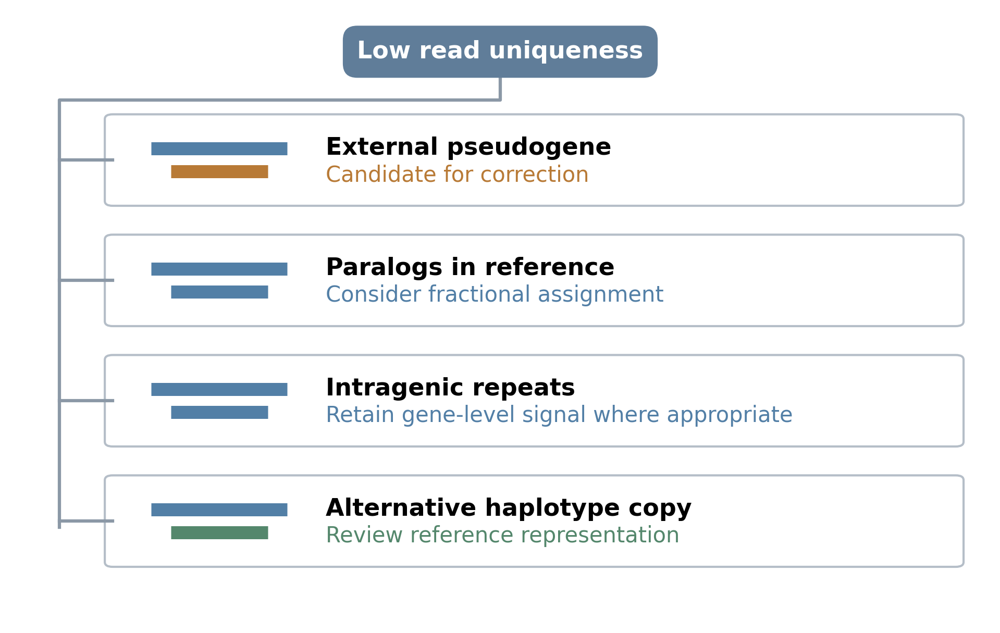

# gene_classification — why a gene is ambiguous, and what to do about it

A Snakemake workflow that takes a genome FASTA and an annotation GTF and returns, for every gene,
the **cause** of non-unique mappability and the **recommended action**. Nothing is specific to
human: the only inputs are the two reference files.

It generalises the classification used in this project
([mappability/STUDY_NOTES.md](../mappability/STUDY_NOTES.md),
[smallPhenomena](../mappability/smallPhenomena/README.md)), which was built for GRCh38 with
hard-coded paths and separate scripts per phenomenon.

```bash
# set genome_fasta and gtf in config.yaml first; with both in place the dry run plans 19 jobs
snakemake --configfile config/config.yaml --use-conda --cores 8 -n
snakemake --configfile config/config.yaml --use-conda --cores 8
```

## Why two separate questions

Low uniqueness is not one problem. The direction of the error, and therefore the remedy, depends
on **where the competing sequence lives**:

- **Outside the reference** (pseudogenes, retrogenes): their reads have nowhere else to go and
  are added to the functional gene. The count is inflated, and multiplying by funique removes the
  share that cannot be attributed.
- **Inside the reference** (paralogs, duplicates): fractional counting already divides those reads
  between the records. Scaling again would correct twice.
- **Inside the gene itself** (tandem repeats): the reads genuinely belong to this gene but cannot
  be placed within it. Nothing should be scaled.
- **A second copy of the same gene in the annotation** (alt haplotypes, patches, scaffolds): not
  biology at all. The reference is wrong for the purpose; rebuild it from the primary assembly.

So the workflow reports `cause` and `action` as separate columns, and only ever advises correction
for the first case.


*The distinction the workflow turns on: low uniqueness means different things depending on where the
competing sequence sits. Only when it is outside the reference (a pseudogene) is scaling the count
the right answer; when both copies are in the reference, fractional assignment already divides the
reads and scaling again corrects twice. Simplified — the full taxonomy is 11 causes and 7 actions,
listed in the two tables below.*

## Causes

From annotation geometry (interval sweep over gene records) and identical terminal sequence
(transcripts whose last *W* bp match exactly, md5-keyed — an exact match, not a similarity
threshold):

| cause | meaning |
|---|---|
| `alt_haplotype_copy` | shares its terminal sequence with another copy of the **same gene symbol** — an alt haplotype, patch or unplaced scaffold |
| `pseudogene_shadow` | shares it with a pseudogene |
| `local_tandem_dup` | shares it with a coding gene on the same chromosome within `local_mb` |
| `distant_paralog` | shares it with a coding gene far away or on another chromosome |
| `self_homology` | its own sequence repeats internally (≥ 5 % of *k*-mers occur twice) |
| `retrogene`, `readthrough` | annotation tag |
| `nested` | interval lies inside a longer gene |
| `overlap_sense`, `overlap_antisense` | shares coordinates with another gene |
| `unique` | none of the above |

A gene usually has several; `cause` is the highest-priority one and `all_causes` lists them all.

## Actions

From funique (reads simulated from the representative transcript, realigned to the genome, share
recovering MAPQ 255) and, optionally, the inflation ratio between a UTR-containing and a CDS-only
index quantified from the same reads:

| action | condition | meaning |
|---|---|---|
| `always_ok` | funique ≥ `uf_high`, not inflated | any pipeline is reliable |
| `apply_correction` | funique below the cut, cause is external | multiply the count by funique |
| `ambiguous_no_correction` | funique below the cut, competitor inside the reference | leave it to fractional counting |
| `prefer_pseudoaligner` | funique high but inflated | the UTR is genuinely unique, so UTR k-mers place reads the CDS alone cannot resolve: quantify against a UTR-containing index |
| `always_wrong` | funique ≤ `uf_zero` and inflated | needs long reads or protein evidence |
| `unquantifiable` | funique ≤ `uf_zero` | no usable unique signal |
| `use_primary_assembly` | `alt_haplotype_copy` | rebuild the reference, do not scale |

## Validation against the project's own results

Run on GENCODE v49 / GRCh38 with the existing funique table, the workflow reproduces the
per-phenomenon uniqueness of the hand-built analyses
([06_unique_genes](../mappability/smallPhenomena/06_unique_genes/)):

| cause | this workflow, mean funique | smallPhenomena, mean UF |
|---|---|---|
| unique | 0.969 (n = 3,907) | 0.977 (n = 3,954) |
| overlap_antisense | 0.981 | 0.963 |
| overlap_sense | 0.978 | 0.962 |
| nested | 0.953 | 0.910 |
| retrogene | 0.905 | 0.851 |
| readthrough | 0.812 | 0.880 |
| local_tandem_dup | 0.573 (n = 679) | 0.718 (n = 407) |
| pseudogene_shadow | 0.102 (n = 29) | 0.190 (n = 19) |

Gene-level agreement is close:

| quantity | this workflow | smallPhenomena |
|---|---|---|
| genes classified | 78,691 | 78,691 |
| nested (top-priority assignment) | 30,336 | 32,538 |
| transcripts in 3'-end clusters | 236,411 | 236,411 |

Both nested figures count only the gene's winning cause, so they are comparable; the 2,202-gene
gap comes from the two priority orderings resolving mixed cases differently, not from one
detecting less. This workflow detects nested in 32,734 genes in total, visible in its `all_causes`
column. Backing tables: [validation/](validation/).

Self-homology independently recovers the same genes as the curated table — NBPF20, NBPF19,
NBPF10, EPPK1 — and adds CR1, LPA and NEB, all genuine tandem-repeat proteins.

`alt_haplotype_copy` is new here. With an alt-containing genome it captures 1,313 coding genes at
mean funique 0.039, concentrated on chr6 and chr17 — the MHC and 17q21.31 alt regions — and the
original framework attributed these to paralogy. Separating them makes the diagnosis explicit:
those genes are not unquantifiable, the reference simply contains each of them twice. This is why
`config.yaml` specifies a primary assembly.

## Validation on a second organism

The organism-independence claim was tested, not assumed: the workflow was run end to end on
*Saccharomyces cerevisiae* (Ensembl R64-1-1, release 115), which exercises every generalisation
point — `gene_biotype` instead of `gene_type`, `Ensembl_canonical` instead of `MANE_Select`, and a
12 Mb genome needing `--genomeSAindexNbases 10`.

All 19 jobs completed. 7,127 genes, 6,600 protein-coding (yeast has ~6,600 ORFs), every gene
resolved through `Ensembl_canonical`, global funique 0.942. Only 20.0 % of genes share coordinates
with another gene, against 75.6 % in human — yeast is gene-dense but carries little of the
antisense and lncRNA annotation that dominates the human overlap classes — and a single
`pseudogene_shadow`, consistent with yeast's very small pseudogene complement.

Known yeast duplications land where they should:

| gene | expectation | cause | funique | action |
|---|---|---|---|---|
| CUP1-1, CUP1-2 | copper-resistance tandem array | `local_tandem_dup` | 0.000 | `unquantifiable` |
| ASP3-1…4 | subtelomeric tandem array | `local_tandem_dup` | 0.000 | `unquantifiable` |
| TEF1, TEF2 | identical EF-1α, near-identical DNA | `distant_paralog` | 0.133 | `ambiguous_no_correction` |
| DDR48 | serine-rich internal repeat | `self_homology` | 0.895 | `ambiguous_no_correction` |
| ENO1, ENO2 | post-WGD ohnologs | `unique` | 0.963 | `always_ok` |
| HHT1/2, HTA1/2, HHF1/2 | histone pairs, identical protein | `unique` | 1.000 | `always_ok` |

The last two rows are the useful negative control: these pairs encode identical or near-identical
proteins, yet synonymous divergence makes their transcripts separable by 100 bp reads. Protein-level
redundancy is not nucleotide-level ambiguity, and only the latter affects quantification. TEF1/TEF2
are the converse case, and are correctly left uncorrected — both copies are in the reference, so
fractional counting already divides their reads.

## Other organisms

Set `genome_fasta` and `gtf`, then check three settings:

- `representative_tag` — `MANE_Select` for human; `Ensembl_canonical` for most other Ensembl
  species; empty to always take the longest CDS. The workflow falls back to the longest CDS for
  any gene without the tag, so an annotation with no canonical tag still runs.
- `star_index_extra` — small genomes need `--genomeSAindexNbases 11` or lower (10 for yeast).
- `cluster_window` — must sit below the bulk of the organism's transcript lengths. At 250 bp it
  leaves 2.4 % of human transcripts below the window but 10.4 % of yeast ones. Short transcripts
  are keyed on their whole sequence rather than dropped, so identical short duplicates still
  cluster (this is how CUP1 is found), but a short transcript matching the *end* of a longer one is
  not detected, and the step prints a warning when more than 5 % fall below the window.

Biotype attributes are read as either `gene_type` (GENCODE) or `gene_biotype`
(Ensembl/RefSeq-derived), and anything containing `pseudogene` counts as one, so no biotype list
needs editing. `readthrough` and `retrogene` come from GTF tags and are simply absent in
annotations that do not carry them.

## Cost

`read_step: 1` places a read at every transcript position, which is exact and slow — the human
run is ~60 M reads for a 100 bp read length. Raise `read_step` to subsample (10 gives a tenth of
the reads and the funique estimate stays within ~0.01 for all but the shortest transcripts).
The STAR index of a mammalian genome needs ~32 GB RAM; `run_inflation: false` removes the two
kallisto arms if only the geometry and funique classification is wanted.

## Files

| file | content |
|---|---|
| `Snakefile` | the workflow |
| `config/config.yaml` | inputs and thresholds, commented |
| `scripts/gtf_geometry.py` | overlap groups, nesting, biotypes, tags |
| `scripts/tx2gene.py` | transcript→gene map and representative transcript per gene |
| `scripts/terminal_clusters.py` | transcripts with identical terminal windows |
| `scripts/self_homology.py` | internal repeats |
| `scripts/simulate_reads.py` | tiled error-free reads |
| `scripts/uniqueness_from_bam.py` | funique from the read-back alignment |
| `scripts/inflation_ratio.py` | UTR vs CDS reference attribution |
| `scripts/classify_genes.py` | cause and action |
